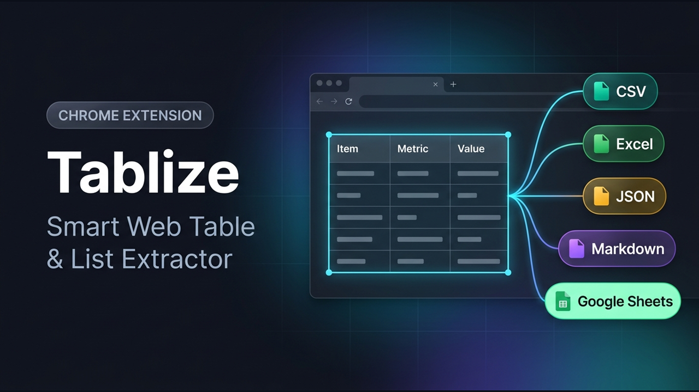

  
  <h1>Tablize — Smart Web Table &amp; List Extractor</h1>
  
<strong>一鍵擷取任何網頁表格與卡片清單，乾淨匯出至 Google Sheets、Excel、CSV、Markdown 與 JSON（100% 本地運算）</strong>

  
Extract any HTML table or repeating visual card list into Google Sheets, Excel (.xls), CSV, Markdown, or JSON in 1 click — 100% local &amp; private.

  

    <a href="https://chromewebstore.google.com/detail/lljfcnmfiohejghpbjhhehgodieacfhm"><strong>Chrome Web Store</strong></a> ·
    <a href="https://microsoftedge.microsoft.com/addons/detail/ilopokankpcfnapmkbaoceadndhomdhe"><strong>Microsoft Edge Add-ons</strong></a> ·
    <a href="https://eggcellent20.gumroad.com/l/bthfdn"><strong>Get Tablize Pro ($12 Lifetime)</strong></a> ·
    <a href="https://egg9372000.github.io/tablize/"><strong>Website</strong></a> ·
    <a href="https://egg9372000.github.io/tablize/privacy.html"><strong>Privacy Policy</strong></a>
  

  

---

> 🌐 **Language / 語言切換**：[繁體中文](#繁體中文介紹) | [English](#english-overview)

---

## 繁體中文介紹

### 什麼是 Tablize？

還在手動複製網頁表格，結果貼到 Excel 或 Google Sheets 全部跑版、亂碼，或是遇到不是 `<table>` 的電商商品卡、職缺清單就完全抓不下來嗎？

**Tablize** 是一款輕量、現代化、**100% 在瀏覽器本地端執行** 的 Chrome / Edge 擴充功能，專為數據分析師、行銷人員、採購、工程師與研究者打造：

- **自動偵測所有 HTML 表格**：開啟彈窗即列出頁面中所有表格與列數／欄數，滑鼠移過即在原網頁高亮框選定位。
- **精準還原合併儲存格**：完整解析 `colspan` 與 `rowspan`，財報、維基百科與複雜儀表板不再錯位。
- **一鍵貼進 Google Sheets (TSV)**：免整理格式，複製後直接 `Ctrl+V` 貼上 Google Sheets、Excel 或 Notion。
- **中文不亂碼 UTF-8 BOM CSV**：內建 UTF-8 BOM 編碼，Microsoft Excel 直接雙擊開啟繁體中文／日文／韓文絕不亂碼。
- **智慧視覺卡片擷取器（Smart Visual Picker，Pro）**：就算網頁不是 `<table>`（例如電商商品網格、職缺列表、目錄卡片），只要點選其中一張卡片，就會自動辨識所有同類項目並拆成整齊欄位。
- **多格式專業匯出與資料清洗（Pro）**：支援樣式化 **Excel (`.xls`)**、**Markdown (`.md`)**、**JSON (`.json`)**，並內建即時搜尋、欄位開關、自動清除幣別符號（`$` / `NT$` / `€` / `¥`）與去除重複列。

### 免費版 vs. Pro 買斷版比較

| 功能 | 免費版（Free） | Pro 終身買斷版（$12 一次性，無月費） |
|---|:---:|:---:|
| 自動偵測網頁所有 HTML 表格（含 `colspan` / `rowspan`） | ✅ | ✅ |
| 網頁高亮定位、即時預覽與關鍵字篩選 | ✅ | ✅ |
| 一鍵複製貼進 Google Sheets (TSV) & UTF-8 CSV 下載 | ✅（每次最多 50 列） | ✅ **無列數上限** |
| **智慧視覺卡片擷取器（非 `<table>` 商品卡／列表網格）** | — | ✅ |
| 匯出 **Excel (`.xls`)**、**Markdown (`.md`)**、**JSON (`.json`)** | — | ✅ |
| 資料清洗（自訂欄位勾選、清除幣別符號、去除重複列） | — | ✅ |
| 100% 瀏覽器本地端運算、零資料上傳、免註冊帳號 | ✅ | ✅ |

### 如何安裝與啟用 Pro 授權

1. **安裝擴充功能**：
   - Chrome 用戶：[前往 Chrome 線上應用程式商店安裝](https://chromewebstore.google.com/detail/lljfcnmfiohejghpbjhhehgodieacfhm) *(審核上線中)*
   - Edge 用戶：[前往 Microsoft Edge 附加元件商店安裝](https://microsoftedge.microsoft.com/addons/detail/ilopokankpcfnapmkbaoceadndhomdhe) *(審核上線中)*
2. **免費使用**：開啟任何含有表格的網頁，點擊瀏覽器工具列的 **Tablize** 圖示即可立即預覽與匯出。
3. **升級 Pro（一次性買斷，無訂閱制）**：
   - 前往 [Gumroad 官方購買頁 ($12 USD)](https://eggcellent20.gumroad.com/l/bthfdn) 完成結帳，系統將立即透過 Email 寄出專屬授權碼（License Key）。
   - 點擊 Tablize 彈窗右上角的 **`FREE`** 徽章 → 貼上授權碼 → 點擊 **`Activate`** 即可永久解鎖全部 Pro 功能。

### 隱私與安全承諾

- **零資料收集**：所有網頁掃描、清洗與檔案產生皆在你的瀏覽器本地端完成，**絕不**收集或上傳任何網頁內容與瀏覽紀錄。
- **最小權限原則**：僅於你點擊工具列圖示時使用 `activeTab` 與 `scripting` 掃描當前分頁；僅於你主動輸入 Pro 授權碼時連線 Gumroad 官方 API 驗證金鑰。詳見 [隱私權政策](https://egg9372000.github.io/tablize/privacy.html)。

---

## English Overview

### What is Tablize?

Stop fighting broken copy-pasting from webpages or paying bloated monthly SaaS fees just to grab structured data.

**Tablize** is a fast, modern, **100% local** Chrome & Microsoft Edge extension that extracts HTML tables, financial reports, pricing grids, and non-table repeating card lists cleanly into **Google Sheets, Excel, CSV, Markdown, or JSON** in one click.

### Key Features

- **Automatic HTML Table Detection**: Instantly discovers every visible `<table>` on the active tab with row/column counts, hover-to-highlight, and one-click scroll-to-locate.
- **Accurate `colspan` & `rowspan` Alignment**: Keeps merged headers and complex tables neatly aligned without shifting columns.
- **One-Click Copy for Google Sheets (TSV)**: Copy clean tab-separated data and paste directly into Google Sheets, Excel, or Notion.
- **UTF-8 BOM CSV Export**: Opens cleanly in Microsoft Excel with zero garbled CJK or Unicode characters.
- **Smart Visual List / Card Picker (Pro)**: Not an HTML `<table>`? Click any product card, job listing, directory item, or CSS grid and Tablize automatically detects all sibling items and structures them into clean columns.
- **Multi-Format Exports & Data Cleaner (Pro)**: Export styled **Excel (`.xls`)**, **Markdown (`.md`)**, and **JSON (`.json`)**; filter rows live, toggle specific columns, deduplicate rows, and strip currency symbols (`$`, `€`, `£`, `¥`, `NT$`) so numbers import cleanly.

### Free vs. Pro (One-Time Lifetime License)

| Feature | Free | Tablize Pro ($12 One-Time) |
|---|:---:|:---:|
| Auto-detect all HTML tables (`colspan` & `rowspan`) | ✅ | ✅ |
| Live preview, hover highlight & row search | ✅ | ✅ |
| Copy for Google Sheets (TSV) & UTF-8 CSV download | ✅ (up to 50 rows) | ✅ **Unlimited rows** |
| **Smart Visual Picker (non-table cards & grids)** | — | ✅ |
| **Excel (`.xls`), Markdown (`.md`) & JSON (`.json`) export** | — | ✅ |
| Data cleaner (column filter, currency strip, dedupe) | — | ✅ |
| 100% local processing, zero tracking, no account needed | ✅ | ✅ |

### Installation & Pro Activation

1. **Install the Extension**:
   - Chrome: [Chrome Web Store](https://chromewebstore.google.com/detail/lljfcnmfiohejghpbjhhehgodieacfhm) *(pending store review)*
   - Microsoft Edge: [Microsoft Edge Add-ons](https://microsoftedge.microsoft.com/addons/detail/ilopokankpcfnapmkbaoceadndhomdhe) *(pending store review)*
2. **Use Free Instantly**: Open any webpage and click the **Tablize** icon in your toolbar.
3. **Activate Tablize Pro ($12 Lifetime — No Subscription)**:
   - Purchase your unique license key on [Gumroad](https://eggcellent20.gumroad.com/l/bthfdn).
   - Open the Tablize popup, click the **`FREE`** badge in the top-right corner, paste your Gumroad license key, and click **`Activate`**.

### Privacy & Permissions

- **100% Local & Private**: Tablize never tracks your browsing history and never uploads webpage contents to any external server.
- **Minimal Permissions**: Uses `activeTab` and `scripting` strictly on demand when you click the toolbar icon; `https://api.gumroad.com/*` is contacted solely when you voluntarily verify a Pro license key. Read the full [Privacy Policy](https://egg9372000.github.io/tablize/privacy.html).

---

  © 2026 Tablize · Built for speed, privacy, and zero subscription fatigue.

